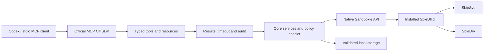

# Architecture

## Components

`SandboxieMcp.Server` owns protocol registration, CLI parsing, dependency injection and tool/result contracts. MCP methods delegate to Core services. `ToolExecutor` converts expected failures into stable structured errors, applies cooperative cancellation, localizes envelopes and records metadata. Stdout is reserved for JSON-RPC.

`SandboxieMcp.Core` owns configuration, authorization, path validation and domain behavior. `SandboxManager` coordinates configuration and lifecycle; separate managers handle processes, files, snapshots, archives, templates, rules, diagnostics and images. Mutations and process startup share a semaphore in each server instance. The native adapter serializes access to Sandboxie's exported API and service calls.

`SandboxieMcp.Tests` contains test fixtures and in-memory doubles used only for unit regressions. Releases contain Core and Server, never the test project. The live Python suite drives the actual stdio server and installed Sandboxie.

## Native boundary

The adapter loads an absolute installed `SbieDll.dll` using DLL-load-directory and System32 search flags. The process must be Windows x64. Exported delegates follow the Windows ABI; service requests use explicit byte offsets and lengths. Request/reply status and response size are checked, native allocations are released and password-bearing request buffers are cleared.

Layouts are tied to [Sandboxie v1.18.5](https://github.com/sandboxie-plus/Sandboxie/tree/v1.18.5):

- `common/defines.h`: 40 UTF-16 characters in native box-name fields.
- `core/drv/api_flags.h`: configuration and feature flags.
- `core/drv/api_defs.h`: 256-character registry-root capacity.
- `core/svc/ProcessWire.h`: launch, process information and suspend/resume requests; the x64 launch request is 124 bytes before its strings.
- `core/svc/MountManagerWire.h`: image requests and replies.
- `core/dll/sbieapi.h` and `sbiedll.h`: exported function contracts.
- `SandboxiePlus/QSbieAPI/SandBox.cpp`: native snapshot storage relationships.

This project independently implements the interoperability layer. Upstream source is a protocol/format reference, not bundled implementation code.

## Configuration integrity

Configuration is read and written through Sandboxie APIs. The server does not rewrite `Sandboxie.ini` with a generic INI parser. A revision is SHA-256 over ordered local settings and their ordered values. Applying changes requires the expected revision, checks for competing writes between settings, saves a local backup and verifies each changed list.

Sandboxie does not expose a multi-setting transaction here. A failure after a write attempt returns `partial_failure` with attempted/completed settings and the backup name. The server does not pretend all-or-nothing rollback occurred. Backups intentionally omit password/certificate/token settings.

## Processes

Launches use a Windows argument array converted with quoting tested against Windows' parser. A curated environment includes required Windows profile variables. Native returned handles retain identity and exit codes for the most recent 256 launches; eviction and server shutdown close handles without terminating their processes. Other process operations verify sandbox membership and creation time where available to reduce PID-reuse risks.

## Storage and snapshots

File tools operate on Sandboxie's materialized storage, not a reconstructed merged filesystem. Destructive file and snapshot operations require no processes in any session. Normal process inventory and controls target the current session.

Snapshots retain Sandboxie's native `snapshot-ID` directories and `Snapshots.ini` graph. Creation freezes `drive/user/share` and data files; restore stages current changes before committing metadata. Incremental `FilePaths.dat` remains in its frozen layer. Invalid IDs, missing references and parent cycles are rejected. Deletion supports unused leaves; merging layers is outside the advertised interface.

Archive transfer uses a separate versioned manifest format. Root paths and secret settings are omitted, extraction is bounded, and imported storage is rebound to a new sandbox. Native GUI archives are not interchangeable with this format.

## Concurrency and limits

The semaphore coordinates one server process. It cannot lock out SandMan, external file writers or another MCP process. Revisions detect many competing configuration/metadata writes, but they are not a cross-process transaction. Avoid simultaneous external mutation of the same sandbox. Path checks do not form an OS-level defense against a hostile same-account process replacing paths between checks and use.

Native calls are synchronous and are not forcibly interrupted. Cancellation is checked while waiting, copying and traversing files. A timeout or cancellation after a native call may leave its side effect in place; callers must inspect state before retrying.
